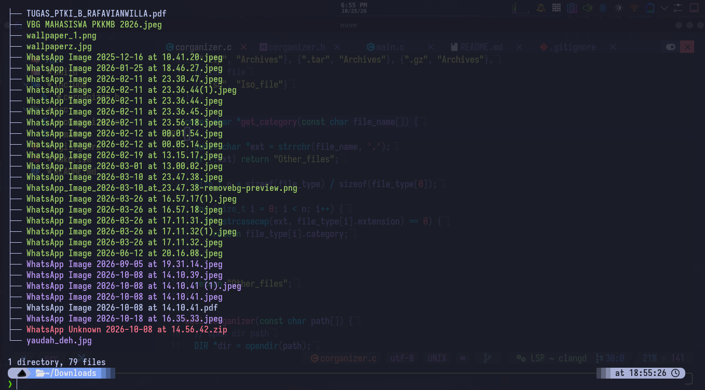
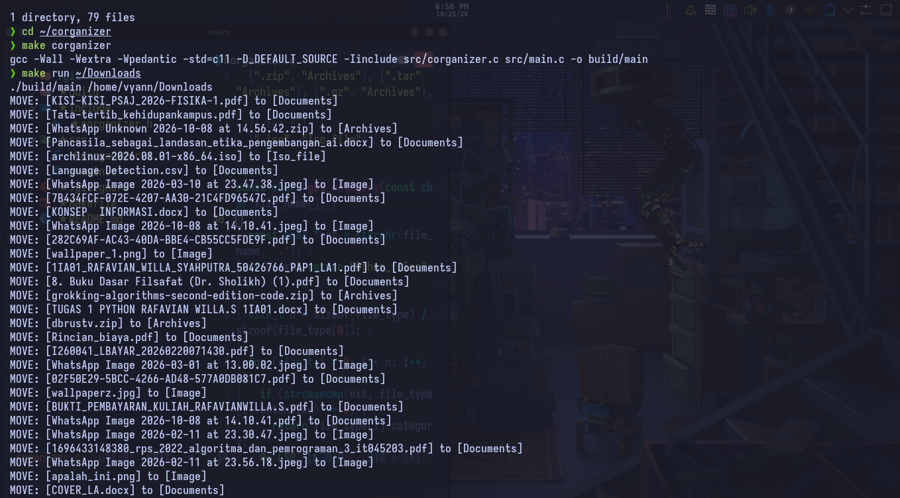
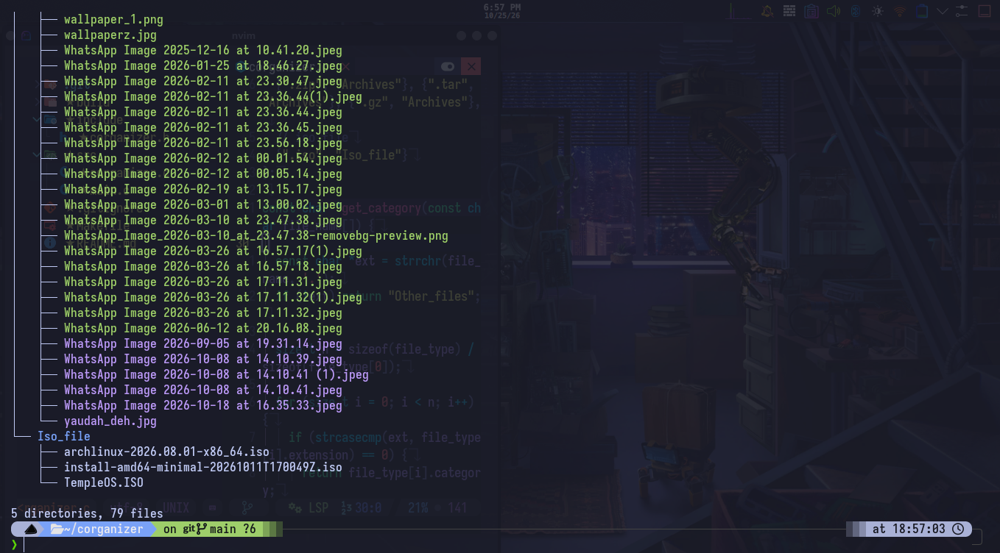

# C Organizer (`corganizer`)

**C Organizer** is a simple file organizer program written in the C programming language. Its purpose is to help users organize files into directories based on their types or file extensions.

With C Organizer, file management becomes more structured, making files easier to find.

## Features

- Organizes files based on their extensions.
- Automatically creates category directories.
- Moves files into their corresponding category directories.
- Skips directories and symbolic links.
- Skips moving files if a file with the same name already exists in the destination directory.
- Allows users to specify their own target directory.

## Showcase






## How to Run

### Prerequisites

Make sure you have the following installed on your system:

- GCC (GNU Compiler Collection)
- GNU Make

If they are not installed, use the following commands depending on your Linux distribution.

**Debian / Ubuntu**
```bash
sudo apt install gcc make
```

**Fedora**
```bash
sudo dnf install gcc make
```

**Arch Linux**
```bash
sudo pacman -S gcc make
```

### Clone the Repository

```bash
git clone https://github.com/vyanwilla7/corganizer.git
```

### Enter the Repository

```bash
cd corganizer
```

### Compile

Run the following command to compile the program:

```bash
make corganizer
```

The executable will be created inside the `build/` directory.

### Run

To run the program, specify the directory you want to organize:

```bash
make run <target_directory>
```

Example using a relative path:

```bash
make run ./test_files
```

You can also use an absolute path:

```bash
make run /home/user/Downloads
```

**Note:** The target directory does not have to be inside the C Organizer repository. You can specify any directory as long as the path is valid and you have the necessary permissions to access it.

### Clean (Optional)

To remove the compiled executable, run:

```bash
make clean
```

## Supported File Categories

C Organizer currently supports the following file categories:

- **Image:** `.jpg`, `.jpeg`, `.png`, `.heic`
- **Code:** `.c`, `.cc`, `.py`, `.rs`, `.java`, `.js`
- **Video:** `.mp4`
- **Music:** `.mp3`
- **Documents:** `.docx`, `.pdf`, `.xlsx`, `.txt`, `.pptx`
- **Data_files:** `.json`, `.csv`, `.xml`
- **Archives:** `.zip`, `.tar`, `.gz`
- **Iso_files:** `.iso`
- **Other_files:** Other file extensions that are not listed above.

## Warning

- Make sure the target directory is correct before running the program.
- The program moves files from their original locations into category directories.
- Files with the same name as existing files in the destination directory will be skipped.
- It is recommended to test the program on a temporary directory before organizing important files.
